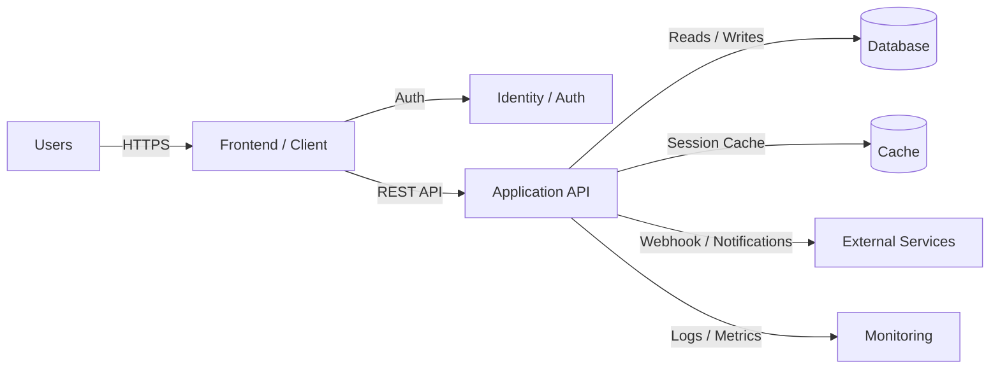

# App

Hairly

This architecture shows the main flow from users to the frontend, through the application API, and into the data layer with supporting services for authentication, caching, monitoring, and external integrations.
